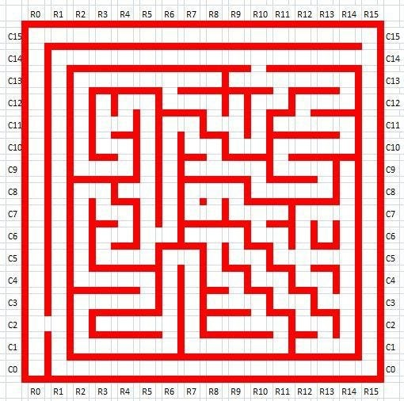

# Micromouse 16x16 A* Pathfinding Simulation

This project is a simulation of the A* (A-Star) pathfinding algorithm designed for a standard 16x16 Micromouse maze. It is built using Python and matplotlib to visualize the shortest path from the start cell S(0,0) to the central 2x2 goal region G.

## Reference Maze Image

The simulation grid and wall structure are based on the following reference maze map:



## Project Structure

* **maze.py**: Defines the `MicromouseMaze` class. Converts the ASCII maze representation into bitmask wall data and handles wall collision checks between adjacent cells.
* **astar_planner.py**: Implements the A* search algorithm using a priority queue (`heapq`), Manhattan distance heuristic, and path reconstruction logic via parent map tracking.
* **simulation.py**: Provides the `MazeVisualizer` class using `matplotlib` to render the grid, walls, Start/Goal regions, mouse icon, and path.
* **main.py**: The primary entry point that executes the pathfinding algorithm and displays the visual simulation window.

## Requirements and Installation

### 1. Prerequisites
* Python 3.8 or higher

### 2. Install Required Packages
```bash
pip install numpy matplotlib
```

### 3. Run the Simulation
Execute the main script to run the algorithm and view the simulation:
```bash
python3 main.py
```

## Algorithm Details

The A* search algorithm calculates the total estimated path cost $f(n)$ for each cell $n$ using the formula:

$$f(n) = g(n) + h(n)$$

Where:
* $g(n)$: The actual movement cost from the start cell S(0,0) to cell $n$.
* $h(n)$: The minimum Manhattan distance heuristic from cell $n$ to any cell in the goal region $G$:

$$h(n) = \min_{(gx, gy) \in G} (|x - gx| + |y - gy|)$$